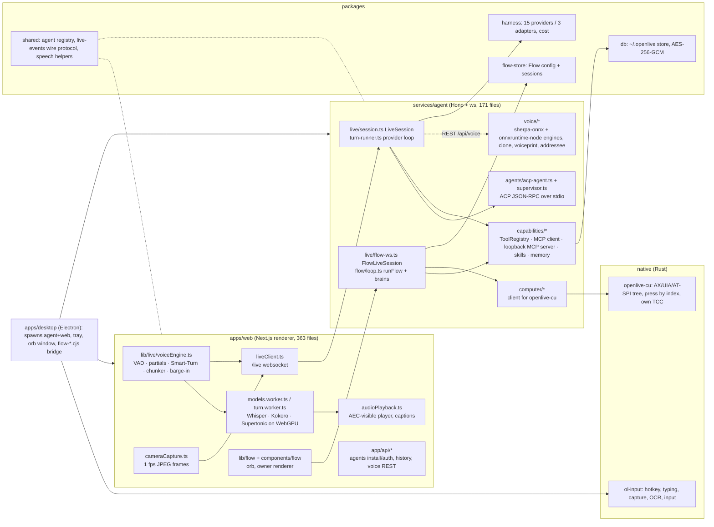

# OpenLive — the Fox map (WINGSCRUM-557)

Fork: `cleverfoxmagic-code/openlive` ← `katipally/openlive` @ `65f2420` (v0.3.2, 731 commits, Apache-2.0). Study only. Mini clone: `/Users/clawdbot/research/openlive` (upstream remote added). Nothing here touches Fox: no shared files, no imports either way.

## What is in this folder

| File | What |
|---|---|
| `MAP.md` | this: module map, how the pieces fit, where each flow lives |
| `INDEX.md` | file → feature index for all 943 tracked files (129 deep rows from the area reads, the rest by area) |
| `voice-loop.md` | process flow + wire protocol of one turn: VAD → STT → Smart-Turn → model → streaming TTS → barge-in |
| `engines.md` | every STT / TTS / VAD / EOT / speaker / addressee engine: size, speed, quality, license, where wired |
| `vision.md` | per-turn frames, the `look` tool, text-only model borrowing a vision model |
| `flow.md` | Flow (double-tap Control → orb → tool loop → actions), every tool per OS, `openlive-cu` and `ol-input` |
| `acp-driving.md` | driving Claude Code / Codex / … over ACP: spawn, resume, prompt, permission relay, supervisor |
| `mcp-memory.md` | MCP connectors, imports, loopback trick, skills, built-in tools, memory.json mechanics |
| `platform.md` | store (~/.openlive), encryption, harness (15 providers), wire protocol, history, desktop shell, Dictate |
| `GAPS.md` | the gap-check against Fox: one table per area + the two plans |
| `graphify-out/` | graphify 0.4.8 over 791 code files: `graph.json` (5,364 nodes / 7,758 edges / 634 communities), `GRAPH_REPORT.md`, `analysis.json` (god nodes), `file_index.json`, `summary.json` |
| `../../openlive-map/gfy_openlive.py` | the graphify runner (same stock extractors + our .mjs/.cjs adapter as the OpenClaw run) |

Graphify caveat (same as the OpenClaw run): its TS import resolution is weak (216 `imports_from` edges for 791 files), so the community count is inflated; the god-node ranking is still right. The module map below comes from reading, not from the graph.

## Module map

Design in one line: **thick client, thin server.** Audio never leaves the renderer; the agent gets final text + frames and streams text back; native engines are a local REST/WS service beside it.

## Where each requested flow lives

| Flow | Trigger | Spine (files) | Success exit | Failure exits |
|---|---|---|---|---|
| Voice loop | mic frame | `voiceEngine.ts` → `models.worker.ts` / `/voice/stream` → `turn.worker.ts` → `liveClient.ts` `user_text` → `live/session.ts` → `sse text_delta` → `SentenceChunker` → `audioPlayback.ts` | reply spoken, `done`, idle | echo drop · blip drop · side-talk shown-not-sent · STT/turn failure → idle · `cancel` on barge-in |
| Vision | turn commit / `look` tool call | `cameraCapture.ts` → `user_text.frames` → `turn-runner.ts withView` · `capabilities/assistant.ts look` → `need_frame` → `captureHiRes` → `frame_response` + binary JPEG | image reaches model / tool result | no vision model → "[picture not sent]" note · 4 s timeout |
| Flow | double-tap Control | `ol-input` hook → `flow-input.cjs` → `useFlowOwner` → orb window → voice loop → `/live?flow=1` `FlowLiveSession` → `flow/loop.ts runFlow` → tools (`openlive-cu` / `ol-input`) → spoken answer | action done + spoken | consent declined (20 s = no) · Stop → `flow_cancel` · failure card per cause |
| ACP driving | call start with a coding agent | registry (`packages/shared`) → spawn adapter → `initialize` → `session/resume`→`load`→`new` → per turn `session/prompt` → `session/update` → `request_permission` relay → `session/cancel` | agent answer spoken, session in agent's own store | supervisor restart (60 s start / 30 s first output / 60 s stall) · permission auto-deny at 120 s |
| MCP + memory | settings / `remember` tool | `~/.openlive/mcp.json` → `ConnectorManager` → `ToolRegistry` → `serveMcp` loopback for agents · `memory.json` ← `remember` tool / Settings → system prompt per turn | tools callable by API brain and agents alike | stdio needs spawn consent · >40 tools held behind `find_tools` |

Each flow is drawn as a Mermaid diagram with failure exits in its own file above.
