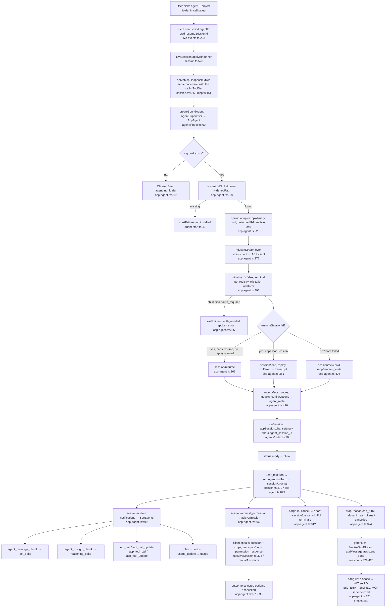

# ACP agent driving — talking to Claude Code / Codex / … by voice

OpenLive (HEAD 65f2420) drives an external coding agent as the "brain" of a voice call over the **Agent Client Protocol** (JSON-RPC over the child's stdio). The browser does all audio; the agent server (`services/agent`) only receives final text + frames, spawns the agent's ACP adapter as a child process, relays its stream, and persists the chat. Nothing is faked: OpenLive advertises no fs capability and lets the agent ask for permission itself.

## Process flow

## 1. Starting a call with a coding agent

**Registry entry.** Every agent is one row in `AGENT_REGISTRY` (`packages/shared/src/agent-registry.ts:115-404`), the single source of id, label, adapter command, bins, install/uninstall recipes, login/logout, session store, credential probe and ACP quirks (`AgentDef`, lines 27-97). The table is browser-safe; node-only helpers live in `packages/shared/src/node/agent-node.ts`.

**Install / sign-in detection (Settings → Agents).** `GET /api/agents` (`apps/web/src/app/api/agents/route.ts:53-90`) runs `which`/`where` for each `bins[]` entry over `widenedPath()` (login-shell PATH + homebrew/npm/.local dirs, `agent-node.ts:42-58`), reads `<bin> --version` (cached by binary mtime+size, lines 30-43), and evaluates `credProbe` read-only (`evalCredProbe`, `agent-node.ts:71-112`: file exists / JSON rule / regex fileMatch / macOS keychain exit code only / anyOf). `POST /api/agents/action` (`action/route.ts:129-178`) streams `npm install -g`, a curl|bash recipe, or opens the login command in a real terminal (`terminalCommand`, `agent-node.ts:149-165`: osascript Terminal.app / `start powershell -NoExit` / first Linux emulator on PATH). OpenLive **never calls ACP `authenticate`**: sign-in is always the agent's own CLI (`acp-agent.ts:286-292`).

**Bind.** The client sends `{t:"bind", agentId, cwd, resumeSessionId}` (`live-events.ts:233`). `applyBindInner` (`session.ts:528-606`) writes `agentCwd:<chat>` and `acpSession:<chat>` settings, stamps `chats.agent_id/cwd` (`setChatContext`), decides `expectReplay` (chat empty + resume id), starts the loopback MCP server once per session (`serveMcp`, line 566), then `createBoundAgent` (`agents/index.ts:60-84`) builds `AgentSupervisor(factory → AcpAgent)` with `startMs: 60_000` (a first `npx` may download the adapter). No folder → no spawn; the turn answers `agent_no_folder` instead of silently using the API brain (`session.ts:372-383`).

**Spawn.** `AcpAgent.start` (`acp-agent.ts:205-301`): cwd must exist (line 209-213); command from registry or the `acpCommand:<id>` setting override (`adapterFor`, line 135-143); `spawn(cfg.command, [...args, ...toolless.args], { cwd, shell: isWin, detached: !isWin, env: {PATH: widenedPath(), ...registry.acp.env, ...piBridge.env, ...toolless.env} })` (line 220-247). `CLAUDE_CODE_ENTRYPOINT=claude-vscode` keeps sessions visible in Claude's `/resume` (registry line 142, comment 230-235). The child is tracked so the agent's own exit kills every tree (`proc.ts:372-384`). Early death before the handshake becomes an actionable `startFailure` classified by stderr/exit code (`startReason`, `agent-start.ts:21-27`: personal_account / auth_needed / outdated / not_installed / exited).

**Handshake** (`acp-agent.ts:307-413`), the exact ACP methods:

| Step | Method | Notes |
|---|---|---|
| 1 | `initialize` | `clientCapabilities: { fs:{readTextFile:false,writeTextFile:false}, terminal: registry.acp.terminal, elicitation:{url:{},form:{}}, session:{configOptions:{boolean:{}}} }`, `clientInfo openlive` (lines 308-324) |
| 2 | `session/resume` | only if `resumeSessionId` && `agentCapabilities.sessionCapabilities.resume` && not a replay-wanted empty chat (line 358-368); no transcript replay |
| 3 | `session/load` | fallback when `loadSession` advertised; replays whole history as `session/update` notifications, buffered into `ReplayMessage[]` (max 200) and ingested only into an empty chat (`bufferReplay` 694-748, `ingestReplay` session.ts:490-504) |
| 4 | `session/new` | `{ cwd, mcpServers, _meta? }` (line 408) |

`mcpServers` = OpenLive's hosted `openlive` server (unless the agent says `mcpCapabilities.http === false`, line 335-337) + the project's `.mcp.json` for `mcp: "passthrough"` agents (`readProjectMcpServers`, `mcp-config.ts:287-326`, max 20 servers; http/sse gated by agent caps). `mcp: "native"` agents (Claude Code, Copilot, Pi) read `.mcp.json` themselves.

**Claude's `_meta.claudeCode.options`** (`buildClaudeMeta`, `acp-agent.ts:80-89`), rides `session/new`, `session/load` and `session/resume`: `persistSession: true` (sessions land in `~/.claude/projects/<cwd-slug>/`), `systemPrompt: { preset: "claude_code", append: <voice preamble + custom instructions + hosted-tools note + remembered notes> }`, `allowedTools: ["mcp__openlive"]` so Claude never asks before an OpenLive tool. Other agents get the same preamble prepended to the **first user message** (`sentPreamble`, line 791).

**Meta → UI.** `reportMeta`/`applyConfig` (lines 416-447) turn `modes`, `configOptions` (category `model` → model picker; `mode` dropped as duplicate; `boolean` → On/Off pair) and legacy `models` session state (Gemini, Kiro) into `agent_meta` (`live-events.ts:136-155`). Switching: `session/set_config_option` (`methods.agent.session.setConfigOption`), `session/set_mode`, legacy `session/set_model` (lines 449-494). `available_commands_update` → slash commands for the composer (line 527-532); a typed `/name args` that the agent advertised is sent alone as the prompt's only text block (`runTurn` line 777).

## 2. A voice turn

`LiveSession.runTurn` (`session.ts:302-431`): persists the user message, wraps emit in `wrapEmitWithNarration` + `createCommentaryGate` (`narrator.ts`), then `agent.runTurn({ text: withReplyLanguage(said, lang), frames, command? }, hideHosted(gate.emit), signal)`.

`AcpAgent.runTurn` (`acp-agent.ts:772-807`) composes the prompt text: `[Always reply in …]` language line (non-English), the reminders clock line `nowLine()` when OpenLive's tools ride along and Reminders is on (line 788), the one-time preamble, a frame note, then `seedText` (text recap after a supervisor restart) + `cutNote` (what the user heard before a barge-in) + `toolsNote` (tool set changed). Frames go as `image` content blocks when `promptCapabilities.image` is true; otherwise a configured vision model describes them first (`describeFrames`, `turn-runner.ts:24-34`).

`prompt()` (lines 809-851) sends **`session/prompt`** and awaits it. `stopReason` handling: `refusal` → spoken error, `max_tokens`/`max_turn_requests` → "say continue" line, `end_turn`/`cancelled` → nothing. A JSON-RPC error *response* (numeric code) is surfaced as `agent_rejected`; a transport failure is thrown so the supervisor recycles.

**Streaming output** (`clientApp`, lines 497-595) maps `session/update`:
- `agent_message_chunk` → `text_delta` (unstamped chunks from an agent that stamps `messageId` are session notices, dropped; Codex's skill-budget banner, lines 163-172, 539-552)
- `agent_thought_chunk` → `reasoning_delta`
- `tool_call` → `acp_tool_call` full snapshot `{id,title,kind,status,content(text|diff|terminal),locations,rawInputJson,rawOutputJson}` (shared schema `tool-call.ts`)
- `tool_call_update` → sparse `acp_tool_update` merged via `mergeToolCall`
- `plan` / `plan_removed` → `todos`
- `usage_update` → `usage {contextTokens:used, contextSize:size, costUsd}` (no output tokens; never fabricated)
- `current_mode_update`, `config_option_update`, `available_commands_update` → `agent_meta` (turn-independent)

Hosted-tool calls the agent reports (title `mcp__openlive__x` / `mcp.openlive.x`, `hostedBy`, `mcp-config.ts:330`) are dropped so they show once as OpenLive's own chips (`hideHosted`, `session.ts:78-84`).

**Narrated progress** (`live/narrator.ts`): a `say` line ("Still reading through the files.", or "Step 2 of 4 — …" from the plan) fires 1.5 s into a tool call if no reply text streamed since, max 4 per turn, 8 s apart (lines 22-76); `say` is voiced client-side and never persisted. The commentary gate speaks the opening line, reroutes mid-tool commentary to the reasoning channel, and voices only the final answer on `flush()` (lines 89-112). Setting `narrateProgress` ("0" disables).

**Client-hosted terminals** (`terminal-manager.ts`): `terminal/create`, `terminal/output`, `terminal/wait_for_exit`, `terminal/kill`, `terminal/release` are served by OpenLive (`acp-agent.ts:639-659`) so command output streams live as `term_output` (80 ms batches, 128 KB default cap, 1 MB max) and barge-in kills the command tree.

## 3. Permission relay (how an ask becomes a spoken yes/no)

1. Agent sends **`session/request_permission`** `{ toolCall, options[{optionId,name,kind}] }`. OpenLive sorts options allow→reject, keeps real `optionId` + `kind` (`acp-agent.ts:603-608`), names the tool (`OpenLive's remember` for a hosted tool), and calls `askPermission("<Agent> wants permission: <title>. Allow it?", options, toolCallId)`.
2. `AgentSupervisor` wraps the ask to set `awaitingUser`, pausing the stall watchdog (`supervisor.ts:41-45, 101`).
3. `LiveSession.askPermission` (`session.ts:655-678`) sends `{t:"permission", reqId, question, options, expiresAt, toolCallId, turn}` (`live-events.ts:125-129`), with a **120 s** timeout that auto-settles to `"deny"` (`PERM_TIMEOUT_MS`). A late ask after the turn ended resolves `PERMISSION_CANCELLED` (line 660).
4. Client (`useLiveSession.ts:316-326`): `engine.ask(question)` speaks it, shows chips, posts a desktop notification, and schedules a spoken reminder 30 s before expiry. While an ask is pending every utterance is routed to `answerModalByVoice` (lines 674-688): `classifyYesNo` (`modalAnswer.ts:5-10`: yes/yeah/sure/ok/approve/go ahead… vs no/nope/deny/stop/cancel…) → `optionForVerdict` picks by ACP **kind first** (`allow_once` before `allow_always`: a spoken yes never means "always", lines 15-21). Ambiguous → "Say yes to allow, or no to reject." Client sends `{t:"permission_response", reqId, optionId}`.
5. Server settles (`settle`, line 667-673): removes the pending entry, emits `permission_resolved` so the chip disappears, resolves the promise. `AcpAgent` answers `{ outcome: { outcome: "selected", optionId } }`; a reject settles the tool card to `rejected` immediately; `PERMISSION_CANCELLED` → `{ outcome: "cancelled" }` and the card to `canceled` (lines 621-635).
6. Barge-in, turn end, a new `user_text` that arrived before the ask reached the client, or socket close all cancel pending asks (`cancelPendingPermissions`, `session.ts:246, 398, 482`).

**Elicitations** (`elicitation/create`, `elicitation/complete`): URL mode opens the browser hands-free and accepts on a spoken "done"; form mode fills a flat schema from speech (`buildElicitationAnswer`, `modalAnswer.ts:26-49`); 120 s timeout → cancel; outside a turn only request-scoped (auth/setup) asks are shown (`session.ts:685-708`, `acp-agent.ts:662-680`).

## 4. Cancel / barge-in

Client `{t:"cancel", spoken}` → `interrupt()` aborts the turn's `AbortController` (`session.ts:249-255, 473-477`). `prompt()`'s abort listener sends **`session/cancel`** (a notification) and `terminals.killAll()`; the awaited `session/prompt` still resolves with `stopReason: "cancelled"` per spec (`acp-agent.ts:812-823`). The saved assistant message is cut to what was actually voiced (`truncateSpokenText`), and `Agent.cut(spoken, cancelled)` queues a `cutNote` for the next prompt ("Of your last reply they heard only: …"), persisted as the `agentCut:<chat>` setting so a reconnect or resume still tells the agent (`session.ts:457-471`, `acp-agent.ts:192-197`). Late events after abort are dropped by the emit gate (`blockEmit`, line 437).

## 5. Supervisor

`AgentSupervisor` (`supervisor.ts`) wraps every agent:
- timeouts `startMs 15 s (60 s for a bound call), firstOutputMs 30 s, stallMs 60 s` (line 16, `agents/index.ts:83`), watchdog ticking every 250 ms (line 100-104), paused while a permission ask is open.
- a hung `runTurn` is raced against the abort so the session never inherits the hang (lines 110-116).
- crash/timeout → `recycle()`: dispose, rebuild via factory, `seed(history)` (last 40 text entries, 4 KB each, lines 20-22), `start` with timeout; **one restart per incident**, budget refreshed after a clean turn (line 119). The failure is spoken out-of-band as an `error` event: "<Agent> stopped responding. I've restarted it — say that again." or "Check that it's installed and signed in." (line 138).
- telemetry: `brain_error` class + `agent_restarts` fact.

## 6. Delegate / worker tool flow (API brain side, served to agents too)

The built-in brain never searches the web itself. `delegate(task)` (`capabilities/assistant.ts:162-179`, group `web`, readOnly) runs `runWorker` (`live/worker.ts:42-81`): a fresh sub-conversation on the same provider with `WORKER_PROMPT` (`prompt.ts:277-281`), tools `web_search` (Exa) + `fetch_url` (SSRF-guarded, DNS-pinned, `capabilities/web.ts:87-142`), max 5 steps, `maxTokens 1024`, minimal reasoning. The worker's text is never spoken; its tool chips stream to the UI; one truthful `say` line ("Still searching for …") after 1.5 s, max 2. The findings string returns as `delegate`'s result for the main voice to relay. Because `delegate` is a registry tool, a coding agent reaches it over the `openlive` MCP server as well.

## 7. Session end and where sessions live

- Hang-up / socket close → `LiveSession.dispose` (`session.ts:743-758`): abort, `agent.dispose()` (`killTree` of the detached process group with SIGTERM then SIGKILL after 2 s, Windows `taskkill /T /F`, `proc.ts:389-401`), MCP server closed, pending asks denied.
- Sessions belong to the agent: Claude `~/.claude/projects/<cwd-slug>/<sessionId>.jsonl`, Codex `~/.codex/sessions/YYYY/MM/DD/rollout-*.jsonl`, Cursor `~/.cursor/acp-sessions/<id>/meta.json`, OpenCode `~/.local/share/opencode/opencode.db`, Hermes `~/.hermes/state.db` (`agentSessions.ts:49-174`). OpenLive keeps the chat + the agent's session id in SQLite (`chats.agent_session_id`, `queries.ts:147-151`) and `acpSession:<chat>` in settings.json, so History dedups and `claude --resume <id>` reopens the same session.
- History discovery: `GET /api/history` lays the agent's own `session/list` (via `GET /agents/sessions`, `models-route.ts:358-376`, initialize-only probe, 60 s cache, never spawned when the CLI is off PATH) over the disk scan (`mergeListed`, `agentSessions.ts:195-205`).
- Flow and Dictate start agents in `~/.openlive/workspace` (`flowAgentCwd`, `agents/index.ts:90-94`); Dictate keeps one toolless agent warm for 5 idle minutes / 20 rewrites (`dictate/rewrite.ts:135-177`).

## 8. Supported agents (registry, `agent-registry.ts:115-404`)

| id | label | ACP adapter (transport = stdio child) | bins | install | login / logout | auth detection (credProbe) | sessions dir / parser | ACP quirks |
|---|---|---|---|---|---|---|---|---|
| `claude-code` | Claude Code | `npx -y @agentclientprotocol/claude-agent-acp@0.100.0` (pinned) | `claude` | npm `@anthropic-ai/claude-code` | `claude auth login` / `claude auth logout` | keychain `Claude Code-credentials` (mac) or `~/.claude/.credentials.json` | `~/.claude`, `claude-jsonl` | preamble via systemPrompt `_meta`, mcp native, terminal, env `CLAUDE_CODE_ENTRYPOINT=claude-vscode`, resumeAcrossRestart |
| `codex` | Codex | `npx -y @agentclientprotocol/codex-acp@2.5.0` (pinned) | `codex` | npm `@openai/codex` | `codex login` / `codex logout` | file `~/.codex/auth.json` | `~/.codex/sessions`, `codex-rollout` | firstMessage preamble, mcp passthrough, terminal; toolless via `CODEX_CONFIG` features-off + `INITIAL_AGENT_MODE=read-only` |
| `cursor` | Cursor | `agent acp` | `agent`, `cursor-agent` | curl `cursor.com/install` / `irm …?win32=true` | `agent login` / `agent logout` | json `~/.cursor/cli-config.json` hasKey `authInfo` | `~/.cursor`, `cursor-meta` | resumeAcrossRestart **false**, passthrough, terminal |
| `opencode` | OpenCode | `opencode acp` | `opencode` | npm `opencode-ai` | `opencode auth login` / `… logout` | json `~/.local/share/opencode/auth.json` nonEmpty | `~/.local/share/opencode`, `opencode-sqlite` (read-only) | passthrough, terminal; toolless `OPENCODE_PERMISSION={"*":"deny"}` |
| `hermes` | Hermes | `hermes acp` | `hermes`, `hermes-acp` | curl `hermes-agent.nousresearch.com/install.sh --skip-setup` | `hermes setup` (wizard), no logout | anyOf: `~/.hermes/.env` `*API_KEY=`, `config.yaml` provider≠auto, `auth.json` has `providers` | `~/.hermes`, `hermes-sqlite` | passthrough, terminal; accepts http MCP without advertising it |
| `gemini` | Gemini CLI | `gemini --acp` | `gemini` | npm `@google/gemini-cli` | `gemini` (TUI picker), no logout | `~/.gemini/oauth_creds.json` / settings `selectedType` / `.env` GEMINI_API_KEY | `~/.gemini`, `none` | passthrough, terminal; models as legacy session state; toolless via `--policy` TOML deny-all |
| `copilot` | GitHub Copilot | `copilot --acp` | `copilot` | npm `@github/copilot` | `copilot login`, no logout | fileMatch `~/.copilot/config.json` `lastLoggedInUser` | `~/.copilot`, `none` (own `session/list`) | mcp native, terminal; toolless `--deny-tool=shell/write/url --disable-builtin-mcps` |
| `kiro` | Kiro | `kiro-cli acp` | `kiro-cli` | curl `cli.kiro.dev/install` | `kiro-cli login` / `kiro-cli logout` | fileMatch token rows in `data.sqlite3` (3 OS paths) | `~/.kiro/sessions/cli`, `none` | passthrough, terminal; legacy models |
| `pi` | Pi | `npx -y pi-acp@0.0.34` (pinned; spawns `pi --mode rpc`) | `pi` | npm `@earendil-works/pi-coding-agent` | `pi` (TUI `/login`) | json `~/.pi/agent/auth.json` nonEmpty or `models.json` | `~/.pi/agent/sessions`, `none` (own `session/list`) | mcp native, **no** terminal, `mcpBridge: piExtension` (temp 0700 dir with launcher + `pi.registerMcpServer` extension, `pi-bridge.ts`) |

All adapters are spoken to over **stdio** (NDJSON JSON-RPC via `@agentclientprotocol/sdk` `ndJsonStream`). OpenLive's own tools reach the agent over **HTTP** (the loopback `openlive` MCP server), or Pi's extension.

## Surprises worth knowing

- OpenLive never hosts fs (`readTextFile/writeTextFile: false`) but **does** host terminals: commands run through OpenLive so they stream and die on barge-in.
- Resume order is `session/resume` → `session/load` → fresh, each failure **silent** (the original stays on disk).
- A permission ask auto-denies at 120 s; the supervisor's stall watchdog is paused meanwhile.
- A spoken "yes" always maps to `allow_once`, never `allow_always`.
- The `openlive` MCP server is stateless per request so a restarted agent reconnects to the same tools; hosted-tool calls are hidden from the agent's own tool cards to avoid double display.
