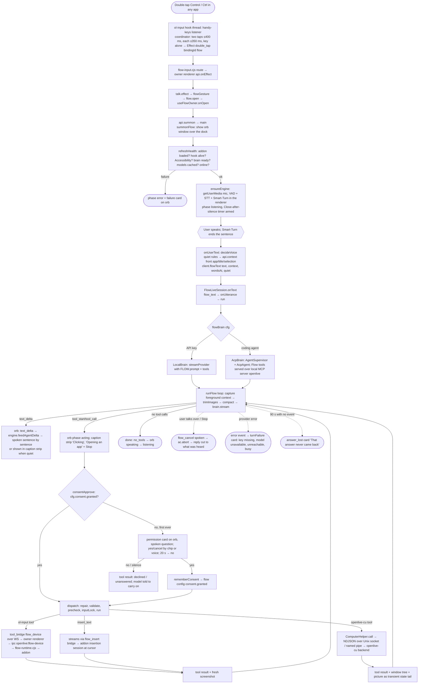

# OpenLive — Flow (the over-the-dock voice assistant and computer use)

Repo: github.com/katipally/openlive @ 65f2420. Study-only map. Line numbers are from this checkout.

Flow = a hidden Electron renderer (`/flow-owner`) that runs the same voice loop as a call, a second `/live?flow=1` WebSocket to the agent service, an always-on-top click-through orb window (`/flow`), and a tool loop (`runFlow`) that drives the machine through two native pieces: `ol-input` (N-API addon in Electron main) and `openlive-cu` (separate Rust helper process owned by the agent service).

---

## 1. One Flow request, end to end

### Process flow

### Narrative, with files

**Trigger**: `native/ol-input/src/hook.rs` (handy-keys `KeyboardListener`, L1-10) feeds `native/ol-input/src/coordinator.rs`, a pure state machine: `DEBOUNCE 30 ms`, `RELEASE_GRACE 50 ms`, `TAP_MAX 350 ms`, `DOUBLE_TAP 400 ms` (L17-26). Main registers three bindings on the hook — `flow` and `dictate` as `toggle`, `ptt` as `hold` — in `apps/desktop/flow-input.cjs` L42-45, L177-200 (`setBindings`/`syncBindings`), defaults Control / Option-Alt / Fn-RightCtrl; QA builds can also use F19/F20/F18 (L51). `initialize()` L130-161 installs the hook, which is what prompts for Accessibility on macOS; `setArmed()` L164 suspends/resumes only the `flow` binding for the on/off switch.

**Routing**: `apps/web/src/lib/flow/talk.ts` `createTalk` L49-138: `effect()` L104-114 turns a `double_tap` on `FLOW_BINDING` into `flowGesture()` (open or close), on `DICTATE_BINDING` into `toggleDictate()`, and `hold_start/end/cancel` on `PTT_BINDING` into push-to-talk; `armSilence()` L58-69 closes an idle session after `closeAfterSilenceMs` (30 s default per `docs/FLOW.md` L147).

**Open**: `apps/web/src/lib/flow/useFlowOwner.ts` `onOpen` L442-507: `summon(by)` → `api.summon()` (preload → `openlive:flow-summon`, `apps/desktop/preload.cjs` L158 → `apps/desktop/main.cjs` `summonFlow` L827); `refreshHealth()` L246-269 derives a `FlowFailure` via `lib/flow/failure.ts` `deriveFailure` L62-100; `ensureEngine()` L332-376 opens the mic and the `VoiceEngine`. Orb window geometry: `main.cjs` L741 `FLOW_W = 416, FLOW_H = 460`, `flowBounds()` L801-811 centred above the dock (`FLOW_MARGIN 112`), click-through with mouse-move forwarding (`setClickThrough` L760-763); on X11 the cursor is polled at 33 ms (`apps/desktop/orb-pointer.cjs` L7, L13-17), on Wayland the window stays solid.

**Utterance → server**: `onUserText` L560-583: Dictate open → typed instead; a pending permission → `answerByVoice`; else `decideVoice()` (auto-quiet, `lib/flow/quiet.ts`, signals from `flow-runtime.cjs` `signals()` L108-122: in-call processes, DND, output muted, mic busy), `api.context()` (`flow-runtime.cjs` `captureContext` L43-56: front app, title, selection, screen), then `client.flowText(...)` (`lib/live/liveClient.ts` L186: `{ t: "flow_text", text, context, lang, turn, wordsAt, speaker, quiet, aside }`). The owner's `LiveClient` is built with `{ flow: true }` (L1044); the server routes `?flow=1` to `FlowLiveSession` (`services/agent/src/live/ws.ts` L63-66).

**Server turn**: `services/agent/src/live/flow-ws.ts` `onText` L335-390 → `onUtterance` L392-399 (mid-turn utterances become `steering`, drained between turns) → `run()` L403-490: reads config, `consented = cfg.consent.granted` (L411), builds `approve` via `FLOW.approval` (L506-514), refreshes tools (`refreshTools` L498-504 keeps the old `ToolSet` when the offer is unchanged so device tools keep their last screenshot), then iterates `runFlow(...)` and relays every event as `{ t: "flow", event, turn }` (L437), recording to the session file (`record` L526-, `saveAssets` L552-565 caps 60 pictures per session).

**Brains**: `brainFor()` L681-745. API key → `LocalBrain` (`services/agent/src/flow/brain.ts` L78-112: `resolveLive()`, `prepareToolImages` for blind models, `streamProvider`, `createProviderMapper` folds provider events into six brain events). Coding agent → `serveMcp` once (L695-719) exposing the same `ToolSet` on a loopback MCP server `openlive`, `AgentSupervisor(new AcpAgent(agentId, …, { cwd: flowAgentCwd(), mcpServers: [wire], preamble: buildFlowAcpPreamble }))` (L721-732), `agent.seed(priorTurns)`, `applyQuietMode()` L789-793 switches the agent to its no-questions mode when consent is held, `answerForAgent()` L800-810 auto-answers the agent's own permission asks with `allow_always`. `AcpBrain` (`brain.ts` L178-222) streams only text and errors; the agent's own tool calls are reported to the orb by kind/file via `onAgentTool` (`flow-ws.ts` L748-762).

**Loop**: `services/agent/src/flow/loop.ts` `runFlow` L138-292. Per iteration: drain steering (L153), capture foreground context (L155, emitted as `context`), `trimImages` (L159, keep 3), `compact` (L162, 128k/16k/12-tail budget L51), system prompt per turn (L165), transient tail = clock note + newest window state + `formatContext` (L200-202), then `brain.stream`. `insert_text` text streams into the document as `tool_args_delta` arrives, gated by `mayStream` consent (L188-198, L220-222). After the stream: tool calls → `dispatch(...)` (L269) in parallel unless `parallel:false`; `r.state` becomes `newestState` (L275); `terminate` ends the run; no step budget (comment L12-15). Prompt: `services/agent/src/flow/prompt.ts` `BASE` L12-32 ("Decide between three things… insert_text / answer out loud / use a tool", "They have already said, once, that you may act on this machine, so never ask for permission"). ACP preamble `buildFlowAcpPreamble` L66-75 names the MCP server and the namespaced tool names (`mcp__openlive__x` / `mcp.openlive.x`, L82).

**Approval**: `services/agent/src/capabilities/approval.ts` `consentApprove` L48-88: `granted()` → run; else ask `CONSENT_QUESTION` (L28-29) once per batch, 20 s timeout = no (L49, L62-66), yes → `remember()` (persisted to flow config by `flow-ws.ts` `rememberConsent` L823-828), no → every call this turn blocked with `DECLINED`/`UNANSWERED` text (L35, L38) and asked afresh next turn. Profile: `capabilities/profiles.ts` `FLOW` L36-41 (order `insert_text, read_selection, clipboard_read, clipboard_write, get_context, set_dictation` first).

**Spoken answer**: `useFlowOwner.ts` `onFlowEvent` L816-855: `text_delta` → `engine.feedAgentDelta` when speaking, else caption; `tool_start/tool_call` → phase `acting` with label from `toolActive()`; `say` → narration; `done` → `endAgentTurn`, back to listening.

### Orb states

`apps/web/src/lib/flow/types.ts` L11: `FlowPhase = idle | listening | thinking | speaking | acting | confirming | error`. The orb maps `confirming` onto the listening look (`apps/web/src/components/flow/FlowOrb.tsx` L57-61) and Dictate onto its own three states. Colours/motion per state live in `apps/web/src/lib/waveOrb.ts` `WAVE_ORB_STATES` L232-264 (listening teal, thinking violet, acting magenta with sweep, speaking blue, error dark red per `docs/FLOW.md` L175-181). Hover controls (close / open OpenLive / mic→Dictate) and the `data-hit` hit-test that keeps the air click-through: `FlowOrb.tsx` L175-249.

### First-use permission ask

`consentApprove` above; UI: `flow-ws.ts` `askPermission` L848-850 → `ask()` L853-870 sends `{ t: "permission", reqId, question, options: YES_NO, expiresAt }`; the owner shows it (`useFlowOwner.ts` `onPermission` L928-936: phase `confirming`, question spoken), answers by chip (`FlowOrb.tsx` L290-299) or voice (`answerByVoice` L944-953, `classifyYesNo`). `Settings > Flow > Access > Act on this machine / Take it back` clears `consent.granted` (`docs/FLOW.md` L262-265). OS grants (Microphone, Accessibility, Screen Recording; the helper's own Accessibility/Screen) are separate and come from `flow-input.cjs` `request()` L314 / `prompt()` L283 and `openlive-cu` `requestPermission`.

### Stop button

`FlowOrb.tsx` L252-256 renders **Stop** in the caption strip while acting and on the card while a question waits; `cmd({ t: "flowStop" })` → `useFlowOwner.ts` `onStop` L550-558: `cancelTurn()` (L523-529: `engine.cutReply()` → `client.flowCancel(heard)`), drop the pending permission, back to listening with the mic open. Server: `flow-ws.ts` L351-371 `flow_cancel` → `cancelPendingPermissions()`, `spoken` recorded, `ac.abort()`; the loop yields `error aborted` then `done aborted` (`loop.ts` L151, L243-247); `truncateToSpoken` (L50-61) cuts the stored reply to what was voiced; `agent.cut()` tells a coding agent the same. Closing Flow (`onClose` L533-540) is the same cancel with `close: true` plus `dismiss`.

### Failure cards

`apps/web/src/lib/flow/failure.ts`: health-derived (`deriveFailure` L62-100): `addon_missing` (L62), `hook_failed` with Linux `/dev/input` guidance (`INPUT_FIXES` L45-49, L66-68), `no_accessibility` (L72), `secure_input` (L80), `no_provider` (L87), `offline` (L97); model download offers `models_missing` (L112-137); per-turn (`turnFailure` L170-186): `brain_setup` for missing/refused key or unknown model (opens Models/Agents/Flow settings), `turn_failed` for out of credit, provider busy, unreachable (Ollama hint), generic. `answer_lost` (`useFlowOwner.ts` L163-168) for 90 s of silence (`ANSWER_SILENCE_MS` L59) or a link drop mid-answer (L1027-1033). `mic_failed` L485-495. Card rendering and the single fix button: `FlowOrb.tsx` L275-333; fix dispatch `useFlowOwner.ts` L968-980. Full user-facing table: `docs/FLOW.md` L287-304.

---

## 2. Every Flow tool

Backend column: **CU** = `openlive-cu` helper (`services/agent/src/computer/tools.ts` → `native/openlive-cu`); **OLI** = `ol-input` addon via `flow_device` bridge (`capabilities/device-tools.ts` → `apps/desktop/flow-runtime.cjs` → `native/ol-input`); **bridge** = owner renderer / Electron main without the addon. Where CU is available, `SUPERSEDED` (`computer/tools.ts` L15-18) removes the OLI versions of `screenshot, read_screen_text, wait, list_windows, click, double_click, right_click, move, drag, scroll, type, keypress, mouse_down, mouse_up` (`capabilities/registry.ts` `machine()` L37-41).

| Tool | What it does | Backend per OS | File:line |
|---|---|---|---|
| `insert_text` | Types the model's words at the user's cursor, streamed as the arguments arrive | OLI insertion session: macOS paste via CGEvent + lazy pasteboard with receipt-based clipboard restore; Windows paste via SendInput + lazy clipboard; Linux types (`kwtype`/`wtype`/`dotool`/`ydotool`/`xdotool`). OpenLive's own window: Electron `insertText` | `capabilities/text.ts` L48-63; `flow-ws.ts` L280-283; `useFlowOwner.ts` L862-874; `flow-input.cjs` L384-395; `native/ol-input/src/inject.rs`, `paste_tx/mod.rs`, `platform/linux.rs` L77-102 |
| `read_selection` | Selected text in the front app (from the per-turn context capture) | OLI `selectedText`: macOS AX `AXSelectedText`; Windows UIA TextPattern; Linux `xclip`/`xsel` (X11) or `wl-paste --primary` (Wayland) | `text.ts` L65-79; `flow-runtime.cjs` L45; `native/ol-input/src/platform/desktop/macos.rs` L593, `windows.rs` L474, `linux.rs` L332-345 |
| `clipboard_read` / `clipboard_write` | Read / set the system clipboard | bridge op `clipboard_read`/`clipboard_write` → Electron main | `text.ts` L81-104; `flow-ws.ts` L304-307; `preload.cjs` L34 |
| `get_context` | Front app, window title, URL, selection | OLI `foregroundWindow` + `selectedText` + Electron `screen` | `text.ts` L106-124; `flow-runtime.cjs` L43-56 |
| `set_dictation` | Turn Dictate on/off (Flow closes for it) | bridge op `flow_dictate` → owner renderer | `text.ts` L126-136; `useFlowOwner.ts` L875-883 |
| `screenshot` | Picture of a display or one window, capped 1024x768, with `ShotGeometry` for coordinates | OLI: macOS `CGWindowListCreateImage`; Windows GDI `BitBlt`; Linux `grim`/`spectacle`/`gnome-screenshot`/`maim`/`import`. Replaced by `get_app_state` under CU | `device-tools.ts` L176-193; `flow-runtime.cjs` L255-260; `native/ol-input/src/capture.rs` L41-66, `coords.rs` L14-15; `platform/desktop/macos.rs` L163, L202-210; `windows.rs` L166, L214-222; `linux.rs` L25, L160-183 |
| `read_screen_text` | OCR with positions in the screenshot's pixel space | OLI OCR over an OLI shot, or over the CU window picture when CU runs: macOS Vision `VNRecognizeTextRequest`; Windows `Windows.Media.Ocr.OcrEngine`; Linux `tesseract … tsv` | `device-tools.ts` L194-209; `computer/tools.ts` L154-169; `native/ol-input/src/ocr.rs`; `macos.rs` L861-906; `windows.rs` L725-796; `linux.rs` L668-706 |
| `wait` | Sleep ≤10 s, then look again | OLI screenshot or CU `getAppState` | `device-tools.ts` L210-222; `computer/tools.ts` L142-153 |
| `list_windows` | Windows with ids and desktop frames | OLI: macOS `CGWindowListCopyWindowInfo`; Windows EnumWindows; Linux `xdotool search`. CU: macOS CG window list; Windows HWNDs; Linux EWMH `_NET_CLIENT_LIST_STACKING` (X11) / AT-SPI frames (Wayland) | `device-tools.ts` L223-234; `computer/tools.ts` L117-127; `macos.rs` L279; `linux.rs` L273; `native/openlive-cu/crates/platform-macos/src/lib.rs` L323-332; `platform-linux/src/ewmh.rs` |
| `get_window` | One window (or the front one) in desktop coordinates | OLI `foregroundWindow` / `windowList` | `device-tools.ts` L235-248 |
| `camera_frame` | One frame from the camera, camera opened and closed for it | Owner renderer `CameraCapture.start()` + `captureHiRes()` (never main) | `device-tools.ts` L249-260; `useFlowOwner.ts` L885-919; `flow-runtime.cjs` L248-249 |
| `click` / `double_click` / `right_click` | Click a point in the last screenshot (OLI) or an element number / point in the last window picture (CU) | OLI: macOS CGEvent click with planned pointer glide; Windows SendInput; Linux `xdotool`/`ydotool`. CU: macOS `AXPress`→`AXConfirm`→`AXOpen` (`AXShowMenu` for right) then posted click fallback; Windows UIA `Invoke`/`Toggle`/`SelectionItem.Select`/`ExpandCollapse` (`ShowContextMenu`); Linux AT-SPI action list or XTEST / portal click | `device-tools.ts` L366-386; `computer/tools.ts` L170-182; `native/ol-input/src/motion.rs`; `platform-macos/src/lib.rs` L392-409; `platform-windows/src/uia.rs` L290-320; `platform-linux/src/roles.rs`, `backend.rs` L670- |
| `perform_action` | Run a named secondary AX action listed in the tree | CU only: macOS `AXUIElementPerformAction` matched case-insensitively against raw or prettified names; Windows pattern names; Linux AT-SPI actions | `computer/tools.ts` L183-190; `platform-macos/src/lib.rs` L410-425; `core/src/tree.rs` L182-198 `meaningful_actions`, L243-248 `pretty_action` |
| `set_value` | Set a field's whole value, read back | CU only: macOS `AXValue` set with type coercion (number/bool/string) and verified read-back; Windows ValuePattern; Linux AT-SPI EditableText | `computer/tools.ts` L191-198; `platform-macos/src/lib.rs` L502-530 |
| `type` | Type into whatever has focus (`paste: true` for clipboard paste) | OLI `typeText`/`keypress`; CU `typeText`/`pasteText`: macOS AX replace-selection first, else posted keys / paste with clipboard restore; Linux AT-SPI EditableText insert, else keysym typing (X11 XTEST) or portal keysyms (Wayland), `wl-copy` paste | `device-tools.ts` L421-427; `computer/tools.ts` L199-206; `platform-macos/src/lib.rs` L426-440, L258 `replace_selection`; `platform-linux/src/backend.rs` L447-520, `clipboard.rs` |
| `keypress` | A chord (`["cmd","s"]`); CU adds `cmdorctrl` | OLI `keypress` (`KEY_SPELLINGS` normalisation); CU `pressKey`/`hotkey`, with `cmd+a` done through AX select-all when possible | `device-tools.ts` L428-439, L331-341; `computer/tools.ts` L207-218; `core/src/keys.rs`; `platform-macos/src/lib.rs` L532-552 |
| `scroll` | Wheel notches at a point (OLI, ±40 cap) or pages on an element/point (CU, ≤20) | OLI wheel events; CU macOS `AXScroll…ByPage` else posted wheel; Windows ScrollPattern else wheel; Linux always posted | `device-tools.ts` L404-420, L320-326; `computer/tools.ts` L219-231; `core/src/serve.rs` L21, L191-204 |
| `move` / `mouse_down` / `mouse_up` / `drag` | Hover, half-clicks and drags | OLI glide (`motion.rs` 125 Hz Bezier path); CU posted pointer events, held-button state for move-while-down | `device-tools.ts` L387-403, L440-453; `computer/tools.ts` L232-269; `native/ol-input/src/motion.rs` L1-20; `core/src/backend.rs` L61-66 |
| `window_activate` / `window_move` / `window_resize` / `window_minimize` / `window_close` | Window management in desktop coordinates | OLI only: macOS AX window attributes; Windows `SetWindowPos`/`ShowWindow`; Linux `xdotool windowactivate/windowmove/windowsize/windowminimize/windowclose` | `device-tools.ts` L454-489; `flow-runtime.cjs` L219-225; `linux.rs` L283-311 |
| `open_app` | Launch or front an app by name | OLI: macOS `NSWorkspace`; Windows `ShellExecuteW`; Linux `gtk-launch` then fallbacks. Without the addon: bridge `open_url` only | `device-tools.ts` L490-497; `macos.rs` L562; `windows.rs` L418; `linux.rs` L315 |
| `open_url` | Open http(s) in the default browser | OLI `openUrl` (macOS `NSWorkspace openURL`, Windows `ShellExecuteW`, Linux `xdg-open`); no device → client bridge `bridgedOpenUrl` | `device-tools.ts` L343-363, L498-503; `macos.rs` L566; `windows.rs` L422; `linux.rs` L327 |
| `shell` | Run a command in `$HOME` through the login shell, 30 s, 64 KB cap (4 KB shown to model) | Electron main `execFile($SHELL -lc …)` / `cmd.exe /d /s /c` | `device-tools.ts` L278-290; `flow-runtime.cjs` L161-246 |
| `list_apps` | Running apps with ids, front first | CU only: macOS `NSRunningApplication` (Regular policy); Windows process list; Linux window owners | `computer/tools.ts` L106-116; `platform-macos/src/lib.rs` L317-321; `platform-windows/src/backend.rs` L228-235; `platform-linux/src/backend.rs` L590-601 |
| `get_app_state` | Numbered accessibility tree + 1280-px picture of one window (the default target is the front non-OpenLive window) | CU only: macOS AX (`objc2-application-services`) + ScreenCaptureKit `SCScreenshotManager`; Windows UIA control view + Windows.Graphics.Capture (PrintWindow fallback); Linux AT-SPI over zbus + X11 `GetImage` or PipeWire portal stream | `computer/tools.ts` L128-141; `core/src/serve.rs` L105-108, L135-150; `platform-macos/src/lib.rs` L364-386, `capture.rs`; `platform-windows/src/uia.rs`, `capture.rs`; `platform-linux/src/atspi.rs`, `x11.rs`, `pipewire.rs` |
| `delegate` | Hand web research to the worker subagent (Exa search, `fetch_url`) | agent service | `capabilities/assistant.ts` L17-37; `capabilities/web.ts` L88, L110 |
| `remember` | Append a fact to shared memory notes | agent service | `assistant.ts` L55-67 |
| `set_timer` / `remind` / `list_reminders` / `cancel_reminder` | Timers and reminders that fire with a notification and a spoken line | agent service | `services/agent/src/reminders/tools.ts` L35, L56, L84, L101 |
| `list_dir` / `read_file` / `write_file` / `edit_file` | Files in `workspace/` (relative) or anywhere in `$HOME` | agent service (`workspace: flowAgentCwd, fence: homedir`) | `capabilities/files.ts` L73, L96, L113, L131; `flow-ws.ts` L312-313 |
| `find_files` | Spotlight / Windows Search / Everything / fallback | agent service | `capabilities/find.ts` L239, L114-124 |
| `list_edits` / `undo_edit` | Checkpointed writes, undoable | agent service | `capabilities/checkpoints.ts` L216, L233 |
| `activate_skill` / `read_skill_file` / `save_skill` | Skills (incl. the `computer-use` skill the CU prompt asks the model to load) | agent service | `services/agent/src/skills/tools.ts` L19, L52, L90, L122-128; `services/agent/skills/computer-use/SKILL.md` |
| `list_connectors` / `add_connector` / `connector_sign_in` / `reconnect_connector` + connector tools (behind `find_tools`/`read_tool`/`use_tool` on demand) | MCP connectors | agent service | `connectors/setup.ts` L56-128; `capabilities/on-demand.ts` |

Not in Flow: `look` (needs `session.share`, Chat only) and `update_todos` (needs `session.emit`) — `assistant.ts` L45, L78; `flow-ws.ts` `toolSession` L301-315 carries neither.

Groups (`capabilities/groups.ts`) let Settings switch whole sets off (`disabledToolGroups`); Flow's `refreshTools` picks that up at the next turn.

---

## 3. `openlive-cu` — the computer-use helper

Location: `native/openlive-cu/crates/{core,helper,platform-macos,platform-windows,platform-linux}`; client `services/agent/src/computer/helper.ts`; tools `services/agent/src/computer/tools.ts`. Adapted from Orca and Cua (`THIRD_PARTY_NOTICES`).

**Who owns it**: the agent service, one helper per server shared by every session (`helper.ts` L11-21). `locateHelper()` L82-93: `OPENLIVE_CU_HELPER` from Electron main (packaged), else the dev build in `native/openlive-cu/dist`; an empty env var disables it. `computer.available()` L126 decides whether a session gets CU tools (`registry.ts` L40, `flow-ws.ts` L311).

**Enumerating controls**: platform `Backend::observe()` (`core/src/backend.rs` L85) walks the window's accessibility tree through `core/src/tree.rs` `render()` L60-121 — a `TreeSource` (L33-40) per OS: macOS `AXUIElement` children (`platform-macos/src/ax.rs`, `lib.rs` L364-386; Chromium/Electron apps get `AXManualAccessibility`+`AXEnhancedUserInterface` set first, L369-373), Windows UIA control view with one CacheRequest per element (`platform-windows/src/uia.rs`), Linux AT-SPI via `org.a11y.Bus.GetAddress` over zbus (`platform-linux/src/atspi.rs`, `bus.rs`). Caps: `MAX_NODES 1200`, `MAX_DEPTH 64`, `MAX_FIELD_CHARS 300` (L43-46). Anonymous `AXGroup`s with nothing to say are elided (L201-206); labelled compact controls suppress their children (L208-224); tab strips ≥10 tabs show only the selected tab in browsers (L47, L124-134). Each kept element gets an index and a line `"{index} {role} ({traits}) {name}, Description: …, Value: …, Placeholder: …, Secondary Actions: …"` (L260-298); password fields render `Value: (hidden)` (L286-288). `tree_text()` L137-156 prefixes `App: … (bundle, pid)` / `Window: "…"` and appends the focused line. Roles are macOS AX vocabulary everywhere (`platform-windows/src/roles.rs`, `platform-linux/src/roles.rs` map onto it).

**"Press by name" — how it actually resolves**: the model does not send a control name. It reads the numbered tree and sends `elementIndex` (`computer/tools.ts` `ELEMENT` L31, `at()` L103). The backend keeps `records[i]` from the last `observe` per window (`platform-macos/src/lib.rs` L384 `self.elements.insert(window.id, rendered.records)`, `element()` L97) and acts on that retained AX handle. What *is* resolved by name:
- The **app**: `Backend::resolve(app, window)` takes a bundle id, a display name, or `pid:<n>`; macOS `find_app()` L155-188: exact bundle id (case-insensitive) → exact lowercase name → unique case-insensitive substring among Regular-policy apps; several matches → `AppNotFound` listing them; none named → frontmost app that is not OpenLive's own (`is_own` via `OPENLIVE_CU_OWN_ROOT`, `core/src/backend.rs` L115-131). Linux `find_app` and front-window fallback: `platform-linux/src/backend.rs` L608-634.
- A **secondary action** name: `perform_action` matches the element's listed actions case-insensitively against the raw `AXScrollDownByPage` or the prettified `scroll down` (`lib.rs` L414, `tree.rs` L243-248).
- A **key chord** by name: `core/src/keys.rs` parses `cmd+shift+p`, `cmdorctrl`.
- Pixel coordinates are accepted only when no element fits; the core maps them through the last picture's `ShotGeometry` and refuses a window that changed size (`serve.rs` L152-163).
Click path on macOS (`lib.rs` L392-409): element → try `AXPress`, `AXConfirm`, `AXOpen` (right button: `AXShowMenu`) → `ActionReport{path:"accessibility", verified:false}`; no action → `focus()` the app, `require_hit()` hit-test, posted CGEvent click at the element centre (`path:"synthetic"`). Windows (`uia.rs` L290-320): list/tree/tab items `SelectionItem.Select` first, then `Invoke`, `Toggle` (read back), `ExpandCollapse`. Linux (`roles.rs`): container Selection for list/tree/tab items, else the first of `click, press, activate, jump, toggle` (`showMenu` for right), else a posted click. `set_value` on macOS coerces to the AX value's current type and verifies by read-back (L502-530). `outcome()` in `computer/tools.ts` L51-58 tells the model "Done … and read back" vs "nothing read it back; the state below is the only evidence".

**Socket protocol** (`core/src/protocol.rs`, `serve.rs`, `framing.rs`): NDJSON, one JSON object per line, 4 MiB line cap. Request `{id, token, method, params}` → `{id, ok:true, result}` | `{id, ok:false, error:{code, message}}` (L1-9, L17-41). `PROTOCOL_VERSION 1` (L15; client `helper.ts` L24). Methods (`serve.rs` L91-125): `handshake`, `terminate`, `permissions`, `requestPermission {id}`, `listApps`, `listWindows {app?}`, `getAppState {app?, windowId?, screenshot?}`, and the actions `click`, `performSecondaryAction`, `setValue`, `typeText`, `pasteText`, `pressKey`, `hotkey`, `scroll`, `drag`, `move`, `mouseDown`, `mouseUp` — each with `settleMs` (default 250, max 3000, L18-19) then a re-`resolve` + `snapshot` so every action answers with `ActionResult{action, state?, stateError?}` (L110-123). Error codes L46-63 (`app_blocked`, `window_not_focused`, `element_not_clickable`, `value_not_settable`, `screenshot_failed`, …). Transport: Unix socket (macOS/Linux) or named pipe `\\.\pipe\openlive-cu-<uuid>` (Windows) in a 0700 temp dir (`$XDG_RUNTIME_DIR` on Linux); client writes a 24-byte random token to a 0600 file (`helper.ts` L176-188), helper reads and deletes it (`core/src/auth.rs` `take_token` L12-19), constant-time compare L22-29; a bad token hangs up (`Ended::Stranger`). Lifecycle: exits when the owner disconnects, on `terminate`, or if unclaimed for 30 s (`helper/src/main.rs` L20, L45-56). Client: connect timeout 10 s, request timeout 30 s → restart, 3 crashes/60 s → rest a minute (`helper.ts` L27-34, L137-141, L247-262). Windows only: `allowForeground(pid)` asks Electron main for `AllowSetForegroundWindow` before every request (`helper.ts` L336-356).

**Its own grants**: `permissions` returns `Grant{id: "accessibility"|"screenRecording", granted, settingsUrl?, detail?}` (`protocol.rs` L106-118). macOS: `AXIsProcessTrusted` and `CGPreflightScreenCaptureAccess`; `requestPermission` calls `AXIsProcessTrustedWithOptions(prompt)` / `CGRequestScreenCaptureAccess()` and opens the System Settings pane (`platform-macos/src/lib.rs` L288-315). The helper is its own app `OpenLive Computer Use.app` (`com.openlive.computer-use`) and re-spawns itself with TCC responsibility disclaimed so the grants attach to it, not to OpenLive (`helper/src/disclaim.rs` L1-19; off in dev via `OPENLIVE_CU_DISCLAIM=0`). Windows: no per-app grant; both read granted whenever there is an interactive desktop, `unsupported` in session 0 (`platform-windows/src/backend.rs` L207-225). Linux: accessibility = `org.a11y.Status.IsEnabled` (set by `requestPermission`, never `ScreenReaderEnabled`; Cinnamon left alone, `platform-linux/src/desktop.rs`); screen = X11 always, Wayland via one xdg-desktop-portal RemoteDesktop+ScreenCast session with a restore token at `<home>/state/portal-token` (`portal.rs`, `backend.rs` L558-588, `helper.ts` L185 `OPENLIVE_CU_PORTAL_TOKEN`). Password managers are refused by bundle id / executable on every OS (`core/src/backend.rs` `BLOCKED_APPS` L93-103, `refuse_blocked` L105-113, checked in `serve.rs` `resolve()` L129-133).

**Screenshots and OCR**: `observe()` captures the one window: macOS ScreenCaptureKit `SCScreenshotManager` (needs macOS 14; `platform-macos/src/capture.rs` L1-6, L28-35), Windows `Windows.Graphics.Capture` with `IsBorderRequired=false` where available and `PrintWindow(PW_RENDERFULLCONTENT)` fallback (`platform-windows/src/capture.rs` L1-12, L115-130, L213), Linux X11 root `GetImage` cropped to the frame or Wayland PipeWire frame composed across monitors (`platform-linux/src/x11.rs`, `pipewire.rs`, `wayland.rs`). Image policy `core/src/image.rs`: `MAX_LONG_EDGE 1280`, `MAX_BYTES 900_000`, PNG if it fits else JPEG q90, else shrink by 0.8 down to 320 px (L19-29). The helper has **no OCR of its own**: `read_screen_text` under CU runs ol-input's `recognizeText` over the helper's picture with an identity `ShotGeometry` (`computer/tools.ts` L160-168). Tree and picture travel as a transient `state` tail, never stored in the transcript (`dispatch.ts` L406-417).

---

## 4. `ol-input` — the N-API addon in Electron main

Location: `native/ol-input` (Rust, `napi 3`, `handy-keys 0.3`, `arboard`, `png`; macOS `objc2-*`, Windows `windows 0.62`, Linux `x11rb`) — `Cargo.toml` L12-50. API surface: `native/ol-input/index.d.ts`. Loaded by `apps/desktop/flow-input.cjs` `load()` L81-88 from `resources/ol-input` (packaged) or the repo.

- **Hotkey**: `initializeHook(onEffect)` installs the global listener (`hook.rs`; `handy-keys` chosen for modifier-only keys, separate down/up and blocking on all three OSes, L3-10). Effects: `double_tap` (toggle role) and `hold_start | hold_end | hold_cancel` (hold role) (`index.d.ts` L1-12). Timing in `coordinator.rs` L17-26. A toggle key shared with the hold key is narrowed to its other side (`narrowToggle`, `index.d.ts` L64-66). macOS secure input: while Secure Event Input is on a CGEventTap loses key events; keyed bindings are shadow-registered through Carbon hotkeys (`secure_input.rs` L1-4, `platform/macos.rs` L121-126); main polls `secureInputStatus()` at 1 Hz (`flow-input.cjs` L107-120). Linux: handy-keys reads evdev under `/dev/input` → needs the `input` group on X11 and Wayland alike; `apps/desktop/linux-input.cjs` `probe()`/`classify()` L20-59 diagnoses `not_in_group | needs_relogin | no_devices | sandboxed` before arming (`flow-input.cjs` L130-150).
- **Typing at cursor**: `insertText` / `beginInsertion` + `pushInsertion` + `endInsertion` (streaming session, `index.d.ts` L75-81; `inject.rs`). Method `paste` (macOS, Windows default) or `type` (Linux default, `inject.rs` L18-26). Paste keycode resolved from the live layout (`inject.rs` L29-54). `InsertionTiming`: `modifierHoldMs 50`, `clipboardQuietMs 200`, `clipboardTimeoutMs 8000`, `restoreClipboard` (`index.d.ts` L14-25).
- **Clipboard restore**: `paste_tx/mod.rs` — the text is published as a *lazy* clipboard promise on macOS and Windows; the paste chord is sent; the clipboard is put back only after the OS reports a consumer read it (receipt), polling at 4 ms, failure cap 600 ms (L1-5, L19-29). Linux sets the clipboard outright, so no receipt (`PROMISES`, L31). Saved content: text first, else image (`clipboard.rs` L15-25).
- **Capture**: `displays()`, `captureDisplay`, `captureWindow`, `captureRegion` → `{png, shot: ShotGeometry}` capped at `MODEL_MAX_WIDTH 1024 × MODEL_MAX_HEIGHT 768` (`coords.rs` L14-15, `capture.rs` L56-66); `shotToScreen` is the only pixel→screen conversion (`index.d.ts` L192-193). Backends: macOS `CGWindowListCreateImage` / display image (`platform/desktop/macos.rs` L163, L202-210); Windows GDI `BitBlt` (`windows.rs` L166, L214-222); Linux external tools `grim, spectacle, gnome-screenshot, maim, import` (`linux.rs` L25, L45-78, L160-183).
- **OCR**: `recognizeText(png, shot)` → boxes in the image's own pixels (`ocr.rs` L35-53). Engines: macOS Vision `VNRecognizeTextRequest` (`macos.rs` L861-906; first call pays ~26 s warm-up, so main warms it on a blank tile, `flow-runtime.cjs` L279-286 `warmOcr`, `device.ts` L113-115), Windows `Windows.Media.Ocr.OcrEngine.TryCreateFromUserProfileLanguages` (`windows.rs` L725-796), Linux `tesseract <png> stdout tsv` word rows (`linux.rs` L668-706). No model bundled; capability reported absent when missing.
- **Input**: `moveMouse/click/doubleClick/rightClick/mouseDown/mouseUp/drag/scroll/typeText/keypress`, all async, pointer travels along a cubic-Bezier path at 125 Hz rather than teleporting (`motion.rs` L1-20; `index.d.ts` L229-249). macOS CGEvent (`platform/macos.rs`); Windows `SendInput` with an elevation check (UIPI: `windows.rs` L500-555 `is_elevated`, `ELEVATED` message); Linux `xdotool`/`ydotool` for the pointer (`linux.rs` L471-501) and `kwtype → wtype → dotool → ydotool → xdotool` for text (`platform/linux.rs` L77-102; wtype skipped on KDE/GNOME). `permissionStatus()` reports `accessibility`, `postEvents` (separate grant on macOS), `microphone`, `screenRecording` (`index.d.ts` L35-44). `capabilities()` reports `hook, postEvents, injection, capture/captureBackend, ocr/ocrEngine, selection/selectionBackend, windowControl, elevatedWindowInjection, secureInput, session, tools` (L164-183) — the device tools refuse rather than fake when a capability is absent (`device-tools.ts` L62-83). Flow's cursor halo while acting: `apps/desktop/flow-cursor.cjs` (transparent click-through overlay sampled every 8 ms, hidden from capture, L1-22).
- **Window / app / selection / misc**: `foregroundWindow`, `windowList`, `activateWindow`, `moveWindow`, `resizeWindow`, `minimizeWindow`, `closeWindow`, `openApp`, `openUrl` (http/https only), `selectedText`, `accessibleSelection`, `focusEditable`, `allowSetForegroundWindow` (Windows), `preventActivation` (macOS), `microphoneInUse` (macOS CoreAudio only), `cursorPosition` (`index.d.ts` L198-227).

---

## 5. What is macOS-only (and what is not)

- **macOS-only**: the helper's own TCC identity and disclaim re-spawn (`disclaim.rs`); `Computer use: Accessibility / Screen` as separate System Settings grants; ScreenCaptureKit window pictures; Vision OCR; AX replace-selection typing; CoreAudio mic-busy signal; Fn as push-to-talk; secure-input detection; Chromium `AXManualAccessibility` nudge; `preventActivation`.
- **Windows**: the helper needs no grant; UIA tree; WGC/PrintWindow capture; Windows OCR; UIPI elevation refusal; `AllowSetForegroundWindow` dance with Electron main; no DND read.
- **Linux**: AT-SPI tree on X11 and Wayland; X11 `GetImage`/XTEST, Wayland portal (RemoteDesktop+ScreenCast, PipeWire) with restore token; `input` group for the hotkey; external tools for ol-input capture (`grim`…), typing (`wtype`…), OCR (`tesseract`), selection (`xclip`/`xsel`/`wl-paste`); wlroots compositors can read/press controls but cannot post clicks or keys; GNOME-only DND.
- **Everywhere**: Flow itself (hidden owner renderer, orb, `/live?flow=1`, `runFlow`, consent-once), the tool registry, ol-input's hook/insertion/capture/OCR seams, the helper protocol and tree renderer (`core` crate), password-manager block list.
