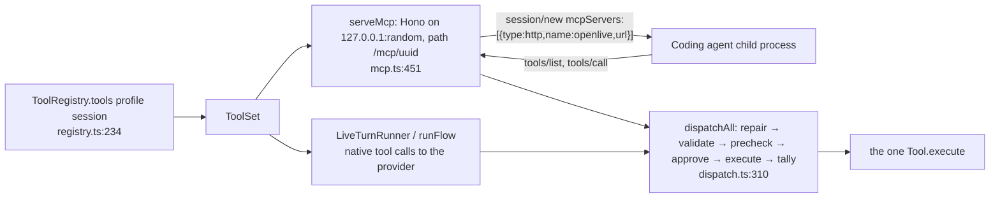
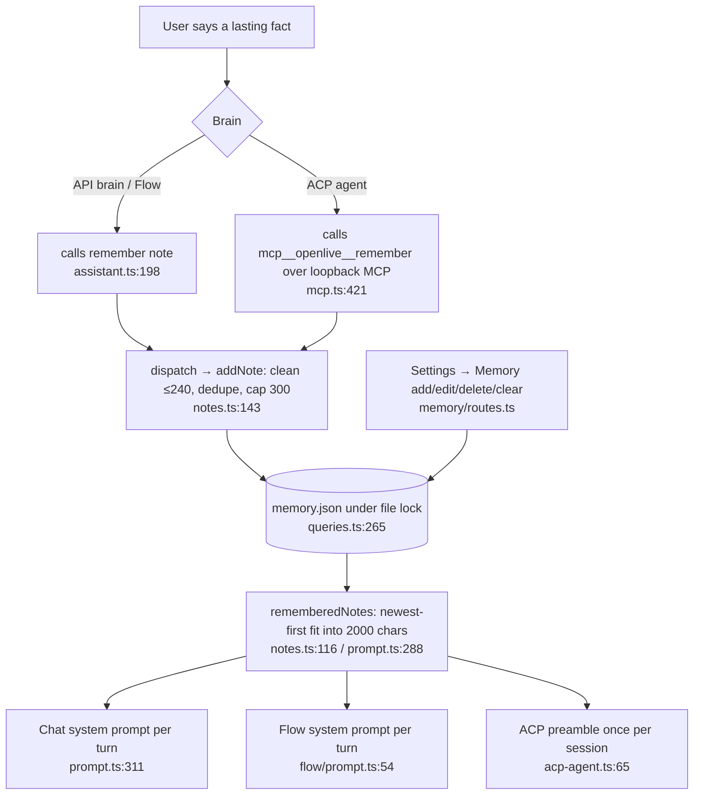

# MCP connectors, skills, built-in tools, and memory

All facts from HEAD 65f2420. One tool registry serves three consumers: the built-in API brain (native tool calls), Flow's loop, and any ACP coding agent (over a loopback MCP server). There is no second tool table anywhere.

## (a) MCP connectors

### Where they live: `~/.openlive/mcp.json` + `secrets/connectors.json`

- Store: `packages/db/src/connectors.ts`. `mcp.json` is the standard `{"mcpServers": {name: entry}}` shape, hand-editable; per server a stdio (`command, args, env, cwd`) or http (`type:"http", url, headers`) transport plus an `"openlive"` block (`id, slug, enabled, disabledTools, source, createdAt, spawnConsent, trustReadOnly?, clientMetadataUrl?, tools cache + toolsAt/toolsTtlMs`) — parsed/written by `packages/shared/src/home/mcp.mjs` (`readMcp`/`writeMcp`, `connectors.ts:27, 39`).
- Secrets: env values whose name looks secret (`/key|token|secret|passw|pat\b|auth|credential|cookie|session/i`, line 48) and **every** header value are replaced in mcp.json by `${secret:NAME}` references; the AES-256-GCM ciphertext (same `encryptSecret` as provider keys) sits in `secrets/connectors.json` by connector id, along with OAuth tokens/client info filed **per issuer** (lines 177-216). Decrypted only in the agent process at connect time (`connectorSecrets`, line 168).
- Every read is fresh from disk; writes go through `withFileLock(PATHS.mcp)` (line 35) and secrets are written before mcp.json so a reference never dangles (line 40-42). A file that is not JSON is never overwritten (`McpFileError`, 409).
- `server.ts:61-68` watches the home dir; a hand edit to `mcp.json` triggers `connectors.reconcile(rows)` 200 ms later, closing any live connection whose decrypted config changed (`manager.ts:125-131`).
- A stdio server never runs until the user consents (`spawnConsent`, `connectors.ts:83`; `POST /connectors/:id/consent`); changing command/args resets consent and `trustReadOnly` (line 119-123).

### Imports (`services/agent/src/connectors/import.ts`)

`importSources()` (lines 145-162), paths per OS (`userConfig` = `%APPDATA%` / `~/Library/Application Support` / `$XDG_CONFIG_HOME|~/.config`):

| Source | Path | Format / parser |
|---|---|---|
| Claude Desktop | `<userConfig>/Claude/claude_desktop_config.json` (+ MS Store `Packages/Claude_pzs8sxrjxfjjc/LocalCache/Roaming/Claude/…` on Windows) | `{mcpServers}` (`fromMcpServers`, 67-79) |
| Claude Code | `$CLAUDE_CONFIG_DIR\|~/.claude.json` | user-scope `mcpServers` then each `projects[dir].mcpServers`, first name wins (`fromClaudeCode`, 87-99) |
| Codex | `$CODEX_HOME\|~/.codex/config.toml` | `[mcp_servers.<name>]` TOML via smol-toml; warns on `env_vars`, `bearer_token_env_var`, `env_http_headers`, `enabled=false` (`fromCodex`, 122-140) |
| Cursor | `~/.cursor/mcp.json` | `{mcpServers}` |
| Gemini CLI | `~/.gemini/settings.json` | `httpUrl` = streamable HTTP, `url` = SSE, `command` = stdio (`fromGemini`, 102-110) |
| VS Code | `<userConfig>/Code/User/mcp.json` | `{servers}`; `${input:x}` placeholders dropped with a warning; `envFile` noted (`fromVsCode`, 113-119) |

Only definitions are imported, never another tool's stored sign-in; `${VAR}` placeholders are stripped and named in warnings (line 37). Duplicates are detected by `sameness()` (command line or normalized URL, 165-169). Imported stdio servers wait for consent.

### The MCP client (`services/agent/src/connectors/manager.ts`)

- One `Client` per connector shared by every session and mode, so a stdio server runs exactly once (line 10-13). Opens on first use; reconnects with backoff 1 s doubling to 60 s, 6 tries (`MAX_RECONNECTS`, line 18-19); every child ends at shutdown (`server.ts:127`).
- Transports: **stdio** (`StdioClientTransport`, 2025 handshake only — the 2026 probe would start a second copy, line 215-230) spawned via cross-spawn with the user's login-shell PATH (`spawn.ts:25-43`); **Streamable HTTP** negotiating the 2026-07-28 era with fallback to legacy then **SSE** (`openHttp`, 237-262).
- Status set: `disabled | needs_consent | disconnected | connecting | connected | needs_auth | error` (line 54-58).
- Tool lists are cached in mcp.json with the server's `ttlMs` (`list`/`store`, 264-279); `tools/list_changed` notifications refresh it (line 207).
- Call timeout 5 min, reset on progress (line 16, 84); a dropped connection retries the call once (line 87-92).
- **OAuth** (`oauth.ts`): authorization-code + PKCE through the MCP SDK's `OAuthClientProvider`; redirect `http://127.0.0.1:<agent port>/connectors/oauth/callback` (the one route exempt from the agent secret, `server.ts:29`); CIMD when `clientMetadataUrl` is set, else dynamic registration (re-registered when the agent's port moves, line 39-45); 10 min flow TTL. Tokens never leave the agent process — an ACP agent only ever sees OpenLive's own MCP server.
- **Elicitation** from a server mid-call is routed to the session whose call asked (AsyncLocalStorage over HTTP; the single caller over stdio; declined when ambiguous, lines 281-303).

### Tool namespacing (`connectors/tools.ts`)

Each enabled tool becomes `<slug>__<tool>`, sanitized to `[a-zA-Z0-9_-]`, cut to 64 chars with a 6-hex hash suffix on collision/overflow (`exposedNames`, 30-44). A server's `readOnlyHint` maps to `readOnly` only when the user ticked "Trust its read-only labels" (`trustReadOnly`); otherwise every connector tool has `confirm` and asks first. Results keep text and ≤4 images ≤5 MB each, text capped at 20,000 chars (`toResult`, 49-75). Registered once at boot: `registry.register(connectorTools())` (`server.ts:57`).

**On-demand loading** (`capabilities/on-demand.ts`): past 40 connector tools or ~8k schema tokens (`AUTO_THRESHOLD`, line 48; mode `connectorToolLoading` auto|on|off), connector tools are held back and replaced by three fixed tools: `find_tools(query, limit?)` (catalog in its description), `read_tool(name, arguments)` (read-only ones only, so Codex runs it without asking) and `use_tool(name, arguments)`. Dispatch unwraps them into the real tool's call (`dispatch.ts:264-279`) so approval, validation and telemetry are the real tool's.

### How the same tools reach API models AND ACP agents (the loopback trick)



- `serveMcp` (`capabilities/mcp.ts:451-471`) starts a stateless MCP handler (`createMcpHandler(() => mcpServer(opts))`, low-level `Server`, not `McpServer`, so dispatch's argument repair still runs) on a random loopback port with a random path token and Host-header validation. `tools/list` serves the session's current `ToolSet.list` with `readOnlyHint` annotations; `tools/call` goes through the same `dispatchAll` and approval as the built-in brain (lines 414-438). The agent's own `claudecode/toolUseId` in `_meta` ties a late call to the turn that made it.
- The wire entry `{ type: "http", name: "openlive", url, headers: [] }` is passed in `session/new`/`load`/`resume` `mcpServers` (`acp-agent.ts:348-351`). Claude Code is also given `allowedTools: ["mcp__openlive"]`; Codex asks for non-`readOnlyHint` tools. Pi gets it via a temp extension (`pi-bridge.ts`). An agent that advertises `mcpCapabilities.http: false` is not sent the server and its preamble stops listing the tools.
- Tool set changes mid-session: `handler.notify.toolsChanged()` (MCP `tools/list_changed`) for 2026-era agents plus a text note on the next turn for older ones (`AcpAgent.toolsChanged`, `acp-agent.ts:199-203`; `session.ts:630-637`).
- The ACP agent's own report of a hosted call (title `mcp__openlive__x`) is hidden so each call shows once (`hideHosted`, `session.ts:78`).

### Skills (`services/agent/src/skills/`)

- Format: [Agent Skills](https://agentskills.io) folders — `SKILL.md` with YAML frontmatter `name` (`[a-z0-9-]`, ≤64, must match folder), `description` (≤1024), optional `license`, `compatibility`, `metadata`, `allowed-tools`; optional `scripts/ references/ assets/` (`parse.ts:12-21`, `shared/src/skills.ts:6-17`). Invalid YAML with colons is retried quoted (`parse.ts:33-40`).
- Sources & precedence (`catalog.ts`): workspace (`<folder>/.agents/skills` over `.claude/skills`) > user (`~/.openlive/skills`, `OPENLIVE_SKILLS_DIR`) > bundled (`services/agent/skills/{computer-use,research,skill-creator,connector-setup}`; packaged beside `agent.mjs`). A same-named skill replaces the built-in (`replacedBy`). Scan stats each SKILL.md, re-parses on mtime/size change (lines 33-47).
- Only disabled state is kept: `state/skills.json` `{disabled: ["source:name"]}` (`db/src/skills.ts`).
- Tools (`skills/tools.ts`, registered at `server.ts:73`): `activate_skill(name)` — enum of enabled skills, catalog in its description, returns `<skill_content>` body (cut at BODY_MAX) plus the folder's file list; `read_skill_file(name, path)` — confined to the skill folder, ≤2 MB/100k chars; `save_skill(name, description, body, replace_built_in?)` — built-in in the Skills group, asks first. A typed `/skill-name …` in the call's composer loads the skill before the turn unless the bound agent advertises that slash command (`slashSkill`, `tools.ts:132-141`; `session.ts:363-368`).
- Imports from Claude Code (`~/.claude/skills`), `~/.agents/skills`, Codex (`~/.codex/skills`), Gemini (`~/.gemini/skills`) by copying folders (`skills/import.ts`).

## (b) Built-in tools (one-liners)

Registered by `builtins` (`capabilities/registry.ts:184-194`) and ordered by profile (`profiles.ts:356-368`: CHAT leads with `delegate, update_todos, remember, look, clipboard_*, open_url, list_dir, read_file, write_file, edit_file`; FLOW with `insert_text, read_selection, clipboard_*, get_context, set_dictation`). Groups (`groups.ts:265-276`) switch off via `disabledToolGroups` in settings.json.

| Group | Tool | One-liner | Asks? |
|---|---|---|---|
| web | `delegate(task)` | hand a web lookup to the worker subagent (`assistant.ts:162`) | no |
| web (worker only) | `web_search(query)` | Exa search → titles/URLs/highlights (`web.ts:87`) | no |
| web (worker only) | `fetch_url(url)` | public page → readable text, SSRF-guarded, 20k chars (`web.ts:109`) | no |
| assistant | `update_todos(items)` | publish/update a 1–8 item checklist in the UI (`assistant.ts:181`) | no |
| assistant | `remember(note)` | save one ≤240-char fact to memory.json (`assistant.ts:198`) | no |
| assistant | `look()` | fresh hi-res frame of the shared camera/screen (`assistant.ts:216`) | no |
| text | `insert_text(text)` | type at the user's cursor via the insertion sink (`text.ts:48`) | Flow consent |
| text | `read_selection()` | selected text in the app in front (`text.ts:65`) | no |
| text | `clipboard_read()` / `clipboard_write(text)` | read / set the clipboard (`text.ts:81, 94`) | write: Flow consent |
| text | `get_context()` | foreground app, window title, URL, selection (`text.ts:106`) | no |
| text | `set_dictation(on)` | toggle hands-free Dictate (`text.ts:126`) | — |
| files | `list_dir(path?)`, `read_file(path)` | explore/read inside the bound workspace (`files.ts:72, 95`) | no |
| files | `write_file(path, content)`, `edit_file(path, find, replace)` | checkpointed writes inside the workspace (`files.ts:112, 130`) | yes (confirm + precheck) |
| find | `find_files(query, kind?, modified_within?, limit?)` | mdfind / Windows Search / fd+locate / BFS walk under home, deny-listed secrets (`find.ts:239`) | no |
| find | `list_edits(limit?)`, `undo_edit(id\|path, force?)` | journal of OpenLive's own edits; restore a pre-image (`checkpoints.ts:216, 233`) | undo: yes |
| reminders | `set_timer(duration, label?)`, `remind(text, at\|in, repeat?)`, `list_reminders`, `cancel_reminder` | local scheduler in `state/reminders.json`, native notification + spoken (`reminders/tools.ts:35-101`) | no |
| skills | `save_skill(...)` | write a new SKILL.md folder (`skills/tools.ts:90`) | yes |
| connectors | `list_connectors`, `add_connector(url\|json)`, `connector_sign_in(id)`, `reconnect_connector(id)` | setup tools for the `connector-setup` skill (`connectors/setup.ts:56-128`) | add: yes |
| computer (ol-input, desktop only) | `screenshot`, `read_screen_text`, `wait`, `list_windows`, `get_window`, `camera_frame`, `open_url`, `click`, `double_click`, `right_click`, `move`, `drag`, `scroll`, `type`, `keypress`, `mouse_down/up`, `window_activate/move/resize/minimize/close`, `open_app` | drive the machine through the Rust `ol-input` addon (`device-tools.ts:177-499`) | actions: confirm |
| computer (helper, where `openlive-cu` runs) | `list_apps`, `list_windows`, `get_app_state`, `wait`, `read_screen_text`, `click`, `perform_action`, `set_value`, `type`, `keypress`, `scroll`, `move`, `mouse_down/up`, `drag` | accessibility-tree computer use, superseding ol-input's pointer/keyboard/screenshot (`computer/tools.ts:107-256`) | actions: confirm |
| shell | `shell` | OpenLive's own command runner on the desktop (`device-tools.ts:279`) | yes |
| (no group) | `activate_skill`, `read_skill_file` | skills, see above | no |
| (no group) | `<slug>__<tool>`, or `find_tools` / `read_tool` / `use_tool` | connector tools | per tool |

Approval policies: a call asks before each `confirm` tool (`askEach`, `approval.ts:517-523`, question "OpenLive wants to <confirm>. Allow it?"); Flow takes consent once per machine (`consentApprove`, 467-507, 20 s timeout = no). Dispatch repairs names/args (`NAME_ALIASES`, coordinate pairs, wrapper keys, `dispatch.ts:32-189`) before validating.

## (c) Memory

### Shape

`~/.openlive/memory.json`: one JSON array, oldest first, of `{ id, text, at }` (`memory/notes.ts:5-6, 89`). Older files held bare strings; both parse (`parseNotes`, 97-111; a string's id is `n` + sha1(text)[0:8]) and every write stores the current shape. It was the `agent_notes` setting before the home migration (`home/index.mjs:255-262`).

Limits (`packages/shared/src/memory.ts`): `NOTE_MAX_CHARS 240`, `NOTES_MAX 300`, `NOTES_BUDGET_CHARS 2000` for the prompt, `noteCost = len + 3`.

### How facts are extracted

**There is no automatic extractor.** Memory is written only when the model (any brain) calls the `remember(note)` tool during a turn (`assistant.ts:198-211` → `addNote`, `notes.ts:143-152`), or when the user adds/edits a note in Settings → Memory (`/memory` routes). `addNote` collapses whitespace, truncates to 240 chars, rejects duplicates by case-insensitive key and refuses at 300 ("Memory is full. Tell the user to delete some notes…"). All mutations go through `updateMemory` under the cross-process file lock (`queries.ts:265-267`, `store.ts:97-115`). No decay, no embeddings, no end-of-call pass.

Coding agents are told to use it instead of their own memory files: `SHARED_MEMORY` ("save it with OpenLive's remember tool, never your own memory files or notes", `prompt.ts:285`) rides the ACP preamble whenever `remember` is among the hosted tools (`acp-agent.ts:65`, `flow/prompt.ts:74`).

### How notes are injected

`rememberedNotes()` (`prompt.ts:288-291`) → `notesInUse()` → `budgeted()` (`notes.ts:116-120`): walks from the **newest** note backwards adding `len+3` until 2000 chars would be exceeded; the first non-fitting note ends the run (an older small note never slips past a newer big one). Rendered as:

```
---
WHAT YOU REMEMBER ABOUT THIS USER (saved earlier; use naturally, don't recite):
- note
- note
```

Prompt positions:
- Chat/API brain: appended to the system prompt after persona, LIVE_RULES, tool guidelines and the date clock, before the user's custom instructions (`buildLivePrompt`, `prompt.ts:301-312`); rebuilt per turn so a note saved this turn shows next turn.
- Flow/API brain: a section of the Flow system prompt (`flow/prompt.ts:54`).
- ACP agents in a call: inside the session preamble — Claude's `systemPrompt.append`, everyone else's first user message (`callPreamble`, `acp-agent.ts:63-66`); read once per session start.
- Flow with an ACP agent: `buildFlowAcpPreamble` embeds `buildFlowPrompt`, which embeds the notes (`flow/prompt.ts:66-75`).
- Dictate rewrites: **no** notes (their prompt is `rewritePrompt`, `dictate/rewrite.ts:61-75`).

### Edit / forget UI path

`/memory` Hono routes (`memory/routes.ts`, proxied at `/api/memory`): `GET /` list (newest first with `inUse` flags, `used`, `budget`, `max`), `POST /` add, `PUT /note/:id` edit, `DELETE /note/:id`, `DELETE /` clear all; each answers the whole list since one change moves the cutoff. Settings → Memory (`MemorySettings.tsx`) shows a budget bar, add, inline edit, delete, clear all, filter.



## Surprises

- Memory is purely tool-driven; "it remembers you" means the model chose to call `remember`. Nothing is extracted after a call.
- Notes past the 2000-char budget are stored but flagged `inUse: false` and never reach any brain until newer ones are deleted.
- The `openlive` MCP server is the **only** way a coding agent reaches connectors; OAuth tokens never cross into the agent process.
- `read_tool` exists solely so Codex (which asks before any non-read-only MCP tool) can run read-only connector tools silently.
