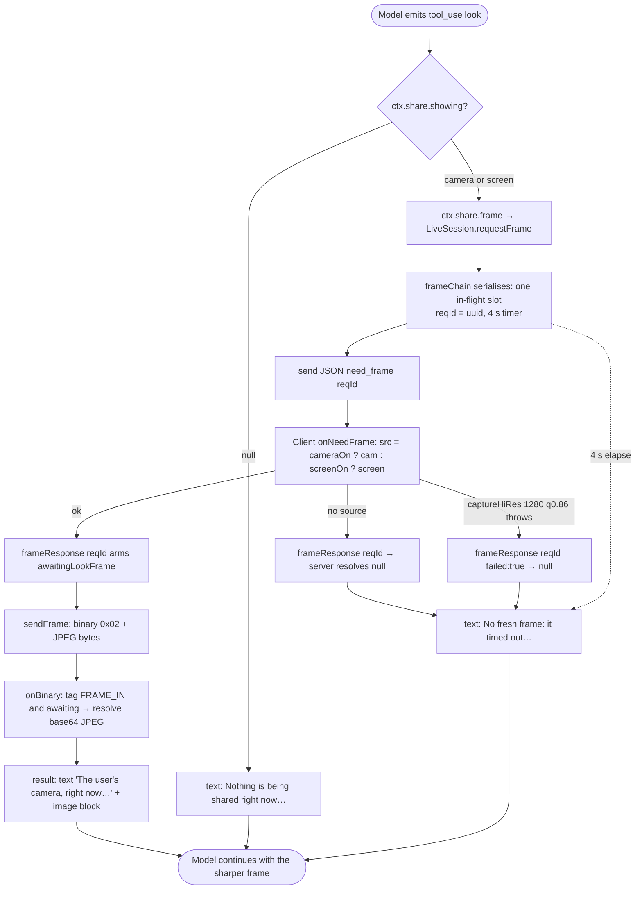

# OpenLive — Vision (camera/screen frames + the `look` tool)

Repo: github.com/katipally/openlive @ 65f2420. Study-only map. Line numbers are from this checkout.

Three paths put pixels in front of the model:

| Path | Who starts it | Where the pixels come from | Where they go |
|---|---|---|---|
| A. Per-turn frame | Every spoken/typed turn in a Chat call while camera or screen share is on | Renderer `CameraCapture` rolling buffer (~1 fps) | Inline in the `user_text` message as base64 JPEG |
| B. `look` tool | The model, mid-turn, in a Chat call | A fresh hi-res grab from the same `CameraCapture` | Tool result (image block) after a `need_frame` round trip |
| C. Vision-model borrow | Server, when the live model can't take images | Same frames / tool screenshots | A text description folded into the turn or the tool result |

Flow has none of A or B. Flow's only camera path is the `camera_frame` device tool (one frame, camera opened for it and closed), and its screen pixels come from `screenshot` (ol-input) or `get_app_state` (openlive-cu). See `flow.md`.

---

## A. Per-turn camera / screen frames

### Process flow

```mermaid
flowchart TD
  T0([User toggles camera or screen in the call UI]) --> T1[useLiveSession.toggleCamera / toggleScreen<br/>new CameraCapture; start or startScreen]
  T1 -->|getUserMedia 1280x720 ideal| S[startSampling: setInterval 1000 ms<br/>grab at sampleSize 640 cam / 1100 screen, JPEG q 0.72<br/>rolling buffer of 6]
  T1 -->|getDisplayMedia frameRate 3| S
  T1 --> C1[client.control camera_on / screen_on → server flips cameraOn/screenOn]
  S --> W{{Turn ends: Smart-Turn says the sentence is done}}
  W --> H[handleUserText: captureFreshest per active source<br/>frames = attachments + camera + screen]
  H --> U[client.userText text + frames base64 + wordsAt + lang]
  U --> SV[LiveSession.runTurn text, frames]
  SV --> B{Bound brain?}
  B -->|provider| TR[LiveTurnRunner.runTurn: resolveVision?]
  B -->|ACP agent| AG[AcpAgent.runTurn: supportsImages?]
  TR -->|vision model set and ≠ live model| D[describeFrames → text note into the user message]
  TR -->|else| V[Live frames ride as a TRANSIENT tail message;<br/>attachments stay on the stored user message]
  AG -->|promptCapabilities.image| IMG[Frames appended as image content blocks]
  AG -->|no image capability + vision model| D
  AG -->|no image capability, no vision model| N["[The user is sharing their X, but you can't view images here]" note]
  V --> OK([Model answers; frame never stored in history])
  D --> OK
  IMG --> OK
  N --> OK
  S -. user hits Stop sharing in OS bar .-> E1[track ended → control screen_off, stop capture]
  H -. tornDown mid-grab .-> E2([Turn dropped, nothing sent])
  T1 -. getUserMedia / getDisplayMedia rejects .-> E3([error toast "Camera access denied" / "Screen share was cancelled"; cameraFailed++])
```

### Narrative, with files

**Capture cadence, resolution, quality** — `apps/web/src/lib/live/cameraCapture.ts`
- `start()` L22-31: `getUserMedia({ video: { width: {ideal:1280}, height: {ideal:720}, deviceId | facingMode } })`, `sampleSize = 640`.
- `startScreen()` L35-42: `getDisplayMedia({ video: { frameRate: {ideal: 3} }, audio: false })`, `sampleSize = 1100` (screens carry small text). Listens for the track's `ended` event to tear down when the OS "Stop sharing" bar is used.
- `startSampling()` L44-48: `setInterval(sample, 1000)` plus one immediate seed. `sample()` L49-54 grabs `grab(sampleSize, 0.72)` and pushes into a 6-deep rolling buffer (`BUFFER = 6`, L13).
- `grab()` L63-72: scales so the long edge ≤ `size`, draws to a canvas, `canvas.toBlob(..., "image/jpeg", q)`.
- `captureFreshest()` L57-59: newest buffered frame, or an on-demand grab if the buffer is empty.
- `captureHiRes(size = 1280, q = 0.86)` L61: the `look` grab.

**Attaching to the turn** — `apps/web/src/lib/live/useLiveSession.ts`
- `handleUserText` L734-755: builds `frames[]` from typed attachments (`source: "attachment"`), then `camRef.captureFreshest()` if `cameraOn` (L743) and `screenRef.captureFreshest()` if `screenOn` (L744), each base64'd as `image/jpeg`. If the session was torn down during the grab the turn is dropped (L746). Then `client.userText(text, frames, wordsAt, speaker, aside, typed)` (L749).
- `toggleCamera` L861-890 / `toggleScreen` L894-926: create the `CameraCapture`, send `control("camera_on"|"screen_on")`, record `featureUsed("n_camera_on"|"n_screen_on")`.

**Wire** — `apps/web/src/lib/live/liveClient.ts`
- `userText()` L181-182 sends `{ t: "user_text", text, frames: [{data, mime, source}], lang?, turn, wordsAt, speaker, aside?, typed? }` as JSON; a user turn is queued across a reconnect (`sendUserTurn` L174-180), frames and all.
- `control()` L194: `camera_on | camera_off | screen_on | screen_off | end`.

**Server intake** — `services/agent/src/live/session.ts`
- Types L28-29: `Frame = {data, mime}`, `TurnFrame = Frame & { source: "camera"|"screen"|"attachment" }`.
- `onText` L239-248: `user_text` → `runTurn(msg.text, msg.frames ?? [], ...)`.
- `control` L256-261 flips `cameraOn` / `screenOn` and emits `camera_used` / `screen_used` facts.
- Barge-in queueing L302-321: a second utterance during a turn is merged; attachments accumulate, but only the freshest live (camera/screen) frames are kept (`live(frames).length ? live(frames) : live(had)`, L314).
- `runTurn` L370 (ACP) / L385 (provider) passes `frames` on.

**Provider brain** — `services/agent/src/live/turn-runner.ts`
- `runTurn` L137-187. Comment L144-147: no hardcoded vision list; frames go to whatever model is picked unless a vision model is configured.
- Live frames are **never stored** in `this.messages`: they become a `transient` tail (`view`, L150-153, L176-179) via `withView()` L55-62 so the stored turn keeps a fixed note (`[The user's camera came with this. Only the newest view is shown, at the end, while they share.]`, L177) and the provider prompt cache survives. Attachments (`source: "attachment"`) stay on the stored user message (L173-175).
- `frameSources()` L17-18 renders "camera and screen" / "attached image" for the notes.

**ACP brain** — `services/agent/src/agents/acp-agent.ts`
- `supportsImages` L155, set from the agent's `promptCapabilities.image` at L327.
- `runTurn` L773-805: image-capable agent gets a note (L794) and `{type:"image", data, mimeType}` blocks (L805); otherwise see path C.

**Privacy gates**
- Camera and screen are opt-in per call (the two toggles); nothing samples while off. Frames go only to "whoever answers" (`docs/FLOW.md` L366-384, `README.md` L202-206 for Flow; the same statement for calls in README L336-349).
- `session.ts` L54 `OPENLIVE_INJECTED`: the saved transcript strips the `[The user is sharing their…]` / `[A vision model is looking at…]` preambles so the history reads as what the user said.
- Remote Ollama confirmation (desktop native dialog) because screen content will reach it: `docs/FLOW.md` L380-384.
- Flow never has an always-on camera; `camera_frame` opens it for one frame (`useFlowOwner.ts` L901-919).
- The cursor halo overlay is `setContentProtection`-style hidden from capture so the agent never photographs its own pointer: `apps/desktop/flow-cursor.cjs` L11-13.

---

## B. The `look` tool (fresh hi-res frame on demand)

### Process flow



### Narrative, with files

**Definition** — `services/agent/src/capabilities/assistant.ts` L69-88
- `name: "look"`, `group: "assistant"`, `readOnly: true`, `parameters: noParams`.
- `available: (s) => !!s.share` (L78) — only a session that carries a `share` port offers it. Chat's `LiveSession` sets `share` at `session.ts` L159: `{ showing: () => screenOn ? "screen" : cameraOn ? "camera" : null, frame: () => this.requestFrame() }`. Flow's `toolSession` (`flow-ws.ts` L301-315) has no `share`, so Flow never gets `look`.
- Prompt guideline L77: "Need a sharper look, to read a small label, a serial, a setting? Call `look`."
- Distinct from `screenshot` on purpose (comment L66-68): `look` is the frame a call is already sharing; `screenshot` is the machine's own display sized for pointing.
- Listed in the CHAT profile order at `capabilities/profiles.ts` L31; telemetry bucket `t_look` at `telemetry/facts.ts` L37.

**Server handshake** — `services/agent/src/live/session.ts`
- State L130-138: `frameChain` (serialiser), `lookPending {reqId, resolve}`, `awaitingLookFrame`.
- `requestFrame()` L722-734: chains on `frameChain` so two parallel `look` calls (the turn runner fans tool calls out with `Promise.all`) cannot clobber the single slot (comment L716-721). Each request: new `reqId`, 4000 ms timeout → `null`, sends `{ t: "need_frame", reqId }`.
- `frame_response` L263-266: wrong `reqId` ignored; `failed` → resolve `null`; otherwise `awaitingLookFrame = true`.
- `onBinary` L229-235: first byte must be `LIVE_TAG.FRAME_IN`; only honoured while `awaitingLookFrame && lookPending`; payload base64'd as `image/jpeg`.

**Client side** — `apps/web/src/lib/live/useLiveSession.ts` L467-476 (`onNeedFrame`) and `liveClient.ts`
- Picks camera over screen when both are on (L469).
- `frameResponse(reqId)` is sent **before** `sendFrame(jpeg)` (L474-475) so the server is armed when the binary lands.
- `liveClient.ts` L212-218 `sendFrame`: `TAG_FRAME_IN = 0x02` (L8) prepended to the JPEG `ArrayBuffer`. L150 dispatches `need_frame` → `onNeedFrame`; L195 `frameResponse`.
- Hi-res grab: `cameraCapture.ts` L61, `captureHiRes(size = 1280, q = 0.86)`.

**Round trip**: tool_use → `requestFrame` → JSON `need_frame` → renderer canvas grab (~ms) → JSON `frame_response` → binary frame → tool result. Bounded at 4 s by the server timer; the renderer answers a failed grab immediately rather than letting the server wait.

**Device-camera variant**: `session.ts` L164 wires `bridgedDevice(..., async () => cameraOn ? this.requestFrame() : null)` so a Chat call's `camera_frame` device tool (desktop with `device=1`) reuses the same handshake instead of opening a second camera.

---

## C. Text-only model borrows a vision model

Two independent describe paths exist; both read the same setting (`visionProviderId` / `visionModel`, `services/agent/src/providers.ts` L56-66 `resolveVision()`; Settings UI `apps/web/src/components/settings/ModelsSettings.tsx` L50-83).

### C1. Live frames on a user turn — `services/agent/src/live/turn-runner.ts`
- `describeFrames(v, userText, frames, sources, signal)` L24-35: one extra provider call to the vision model with system prompt "You are the eyes of a voice assistant. In 1-3 tight sentences, state exactly what is visible…", user text `The user said: "…". What's visible?` plus the images, `maxTokens: 512`, output not spoken.
- Called from `runTurn` L160 only when `vision && vision.model !== model`. Failure → fall back to attaching the frames directly (L160 catch). Result is folded into the user text as `[A vision model is looking at the user's ${sources} live right now and reports: …]` (L164).
- ACP agents: `acp-agent.ts` L782-783 take the same path when `!supportsImages`; with no vision model configured the agent gets `[The user is sharing their X, but you can't view images here — ask them to describe…]` (L796).

### C2. Pictures inside tool results (screenshots, `get_app_state`, `camera_frame`) — `services/agent/src/tool-images.ts`
- `takesImages(provider, model)` L43-53: Ollama `/api/show` capabilities (L22-36, 2.5 s lookup), then models.dev catalog `modalities.input` includes "image", then the name heuristic `modelVision()`; definite answers cached per `baseURL + model`.
- `prepareToolImages(messages, live, signal, described, eyes = resolveVision)` L84-112: if the live model sees, messages pass unchanged. Otherwise every `tool` message with images, and the transient window-state tail (`role === "user" && transient`), is rewritten: images removed, text gains either `[${live.model} cannot take images, so ${helper.model} looked at the picture…: ${text}]` (L108) or the blind note `[A picture came with this result, but X cannot take images, so it was not sent. Do not describe it or say you can see it…]` (L73-74).
- `describe()` L57-71: system prompt `DESCRIBE` (L55) asks for app/window, all readable text quoted exactly, controls and approximate x,y positions; `maxTokens: 800`; `said` is the tool's own result text (L104).
- Descriptions are memoised by `callId` (tool) or a sha1 of the images (state tail) so a transcript resent every turn is described once (L101-107).
- Callers: Flow's `LocalBrain.stream` (`services/agent/src/flow/brain.ts` L95-96, `described` map at L81) and the Chat turn runner (`turn-runner.ts` imports `prepareToolImages` L9).
- Image retention: `services/agent/src/flow/retention.ts` L10 `KEEP_IMAGES = 3`; `trimImages()` keeps only the newest three image-bearing tool results in context. The openlive-cu window state is held outside the transcript entirely (`capabilities/dispatch.ts` L406-417 `newestState` WeakMap, `asStateTail`) and sent as a transient tail each request.

---

## Facts worth keeping

- Per-turn frame: 1 fps sampler, 6-frame buffer, JPEG q 0.72, 640 px long edge for camera / 1100 px for screen. `look`: 1280 px, q 0.86, fresh grab, 4 s server timeout, single in-flight slot serialised.
- Live frames are transient (never written into model history or the saved transcript); attachments are not.
- `look` exists only where a call shares (`session.share`); Flow uses `camera_frame` (one-shot) and `screenshot` / `get_app_state` instead.
- Vision borrowing has two engines: `describeFrames` (voice-turn frames, 512 tokens, 1-3 sentences) and `tool-images.describe` (tool screenshots, 800 tokens, positional detail). Both require a separately configured vision provider/model; neither fakes sight when none is set.
- `apps/web/src/lib/look.ts` and `apps/desktop/look.cjs` are the Glass/Flat appearance "look", not this tool.
